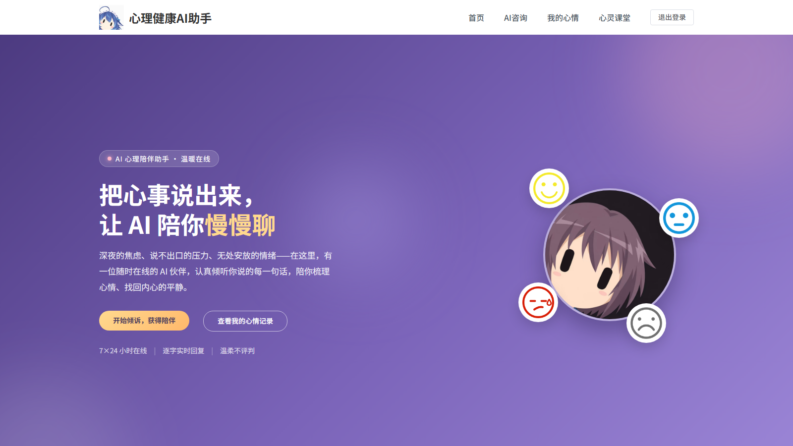
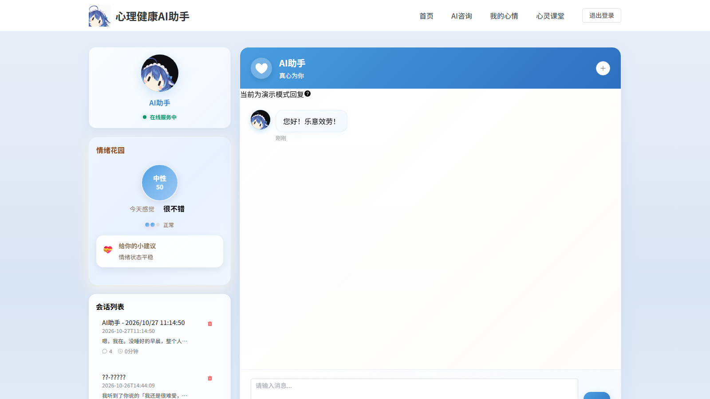
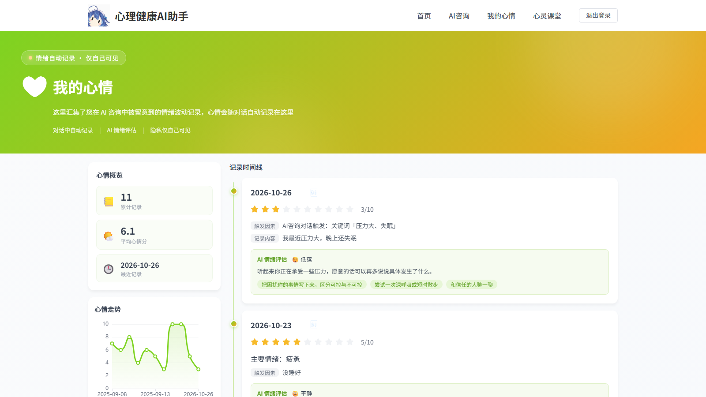
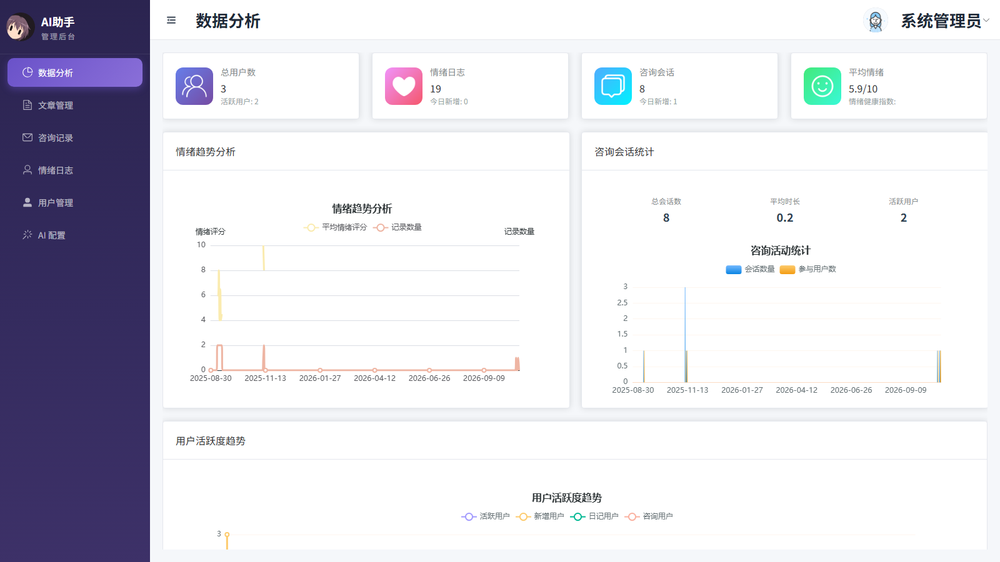
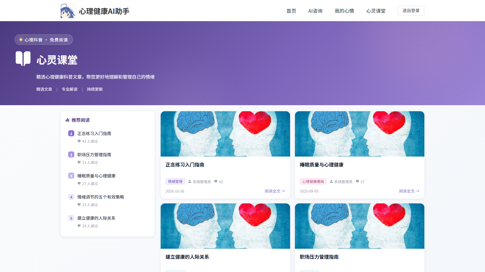
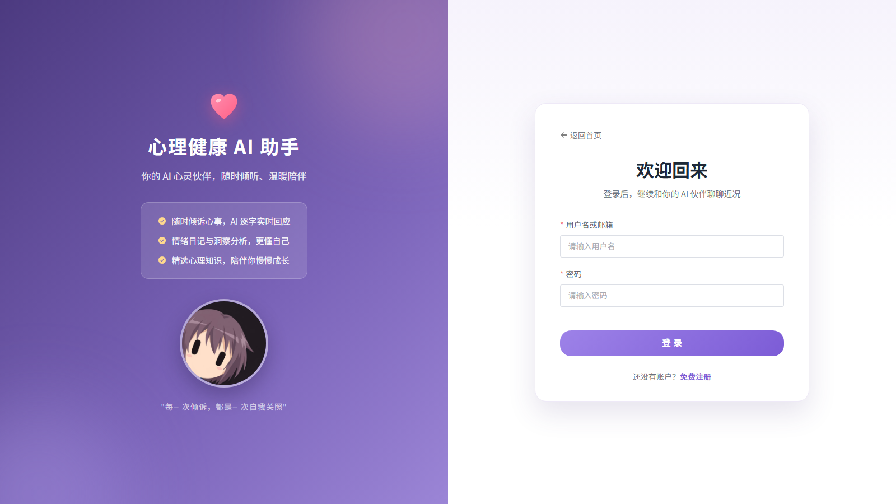
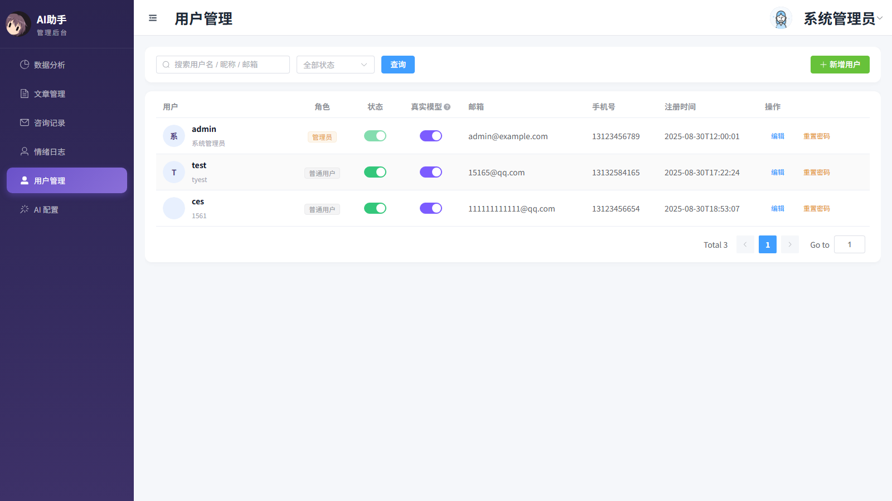
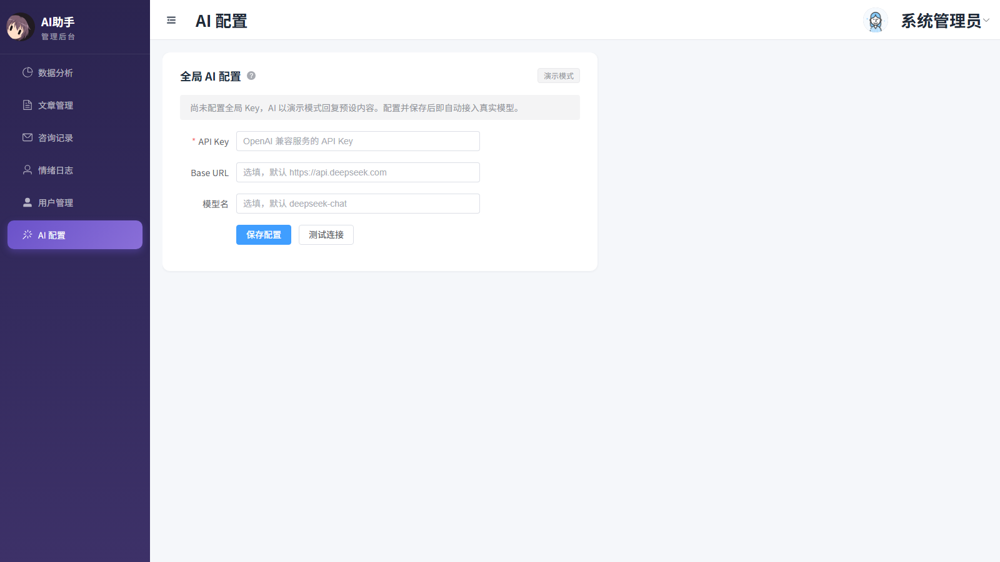

# 心理健康 AI 助手

> 一个面向情绪陪伴与心理疏导场景的全栈 Web 应用：AI 流式对话、情绪日记、心理知识库与管理后台。

[](https://github.com/GuT5torm/AI-mental/actions/workflows/ci.yml)

## 项目简介

本项目是一个个人全栈实践项目，围绕"情绪记录 + AI 陪伴 + 心理知识科普"构建，包含完整的前端、后端、数据库结构与自动化测试。

用户可以通过 AI 咨询获得即时陪伴，在情绪日记中记录每日状态并获取结构化分析；同时，管理员可以在后台查看运营数据、管理知识文章、查阅咨询记录与情绪日志。

## 界面预览

| 首页 | AI 咨询 |
| --- | --- |
|  |  |

| 情绪日记 | 数据看板 |
| --- | --- |
|  |  |

| 知识库 | 登录页 |
| --- | --- |
|  |  |

| 用户管理 | AI 配置 |
| --- | --- |
|  |  |

## 功能特性

### 用户端

- **账号体系**：注册、登录、退出登录，密码使用 BCrypt 加密存储；登录失败按账号锁定（15 分钟内 5 次失败锁 15 分钟），注册按 IP 限流防批量刷号
- **AI 咨询**：创建咨询会话、查看历史会话、删除会话；对话中命中情绪关键词（58 词三级严重度词库）时自动记录心情——按命中词的最重等级推导初始分（轻度 4 分、中度 3 分、重度 2 分，同等级命中 ≥3 个词再降 1 分），并推送 AI 评估提示卡；AI 评估完成后回写修正心情分
- **流式对话**：基于 SSE（Server-Sent Events）逐字返回 AI 回复；未配置 Key 或管理员关闭了本账号的真实模型时为演示模式（预设回复），悬停提示条上的问号图标可查看说明
- **会话情绪分析**：查看单次会话的情绪标签、关键词与建议
- **我的心情**：只读查看个人情绪记录，支持统计概览与心情走势图；记录由 AI 咨询对话自动生成，无需手动录入
- **异步情绪分析**：日记生成后由后台任务队列异步补充结构化分析结果
- **心灵课堂**：分类浏览心理文章、置顶文章展示、文章详情阅读

### 管理后台

- **数据看板**：用户总数、活跃用户、日记数、会话数、平均情绪评分、情绪趋势、咨询趋势、用户活跃度
- **文章管理**：文章增删改查、封面与图片上传、发布/下线、置顶、分类树管理
- **咨询记录**：查看全部用户的会话列表与消息明细
- **情绪日志**：查看并删除用户情绪日记
- **用户管理**：管理员可直接新增用户（支持自定义初始密码）、编辑资料、启用/禁用、重置密码，并可按用户开关真实大模型（关闭后强制演示模式）
- **AI 配置**：管理员维护全局大模型 API Key（AES-GCM 加密存储，界面只回显掩码），支持自定义 OpenAI 兼容端点与模型名、一键连通性测试；保存后立即对全部用户生效，无需重启

## 技术栈

### 后端

| 技术 | 版本 / 说明 |
| --- | --- |
| Java | 17 |
| Spring Boot | 3.5.11 |
| MyBatis-Plus | 3.5.17 |
| PostgreSQL | 16 |
| JJWT | 0.12.6（HS256） |
| BCrypt | `spring-security-crypto` |
| 接口文档风格 | REST + 统一 `Result` 响应体 |
| 实时通信 | Spring MVC `SseEmitter` |

### 前端

| 技术 | 版本 / 说明 |
| --- | --- |
| Vue | 3.5（`<script setup>`） |
| Vite | 8 |
| Element Plus | 2.14 |
| Pinia | 4 |
| Vue Router | 4（含登录与角色守卫） |
| Axios | 请求封装与统一拦截 |
| ECharts | 6（后台图表） |
| WangEditor | 富文本文章编辑 |
| Sass | 样式预处理 |

## 系统架构

```text
浏览器（Vue 3 SPA）
        │  /api/*  （开发环境经 Vite 代理）
        ▼
Spring Boot 3
  ├── JWT 拦截器 + UserContext（ThreadLocal）
  ├── REST Controller → Service → MyBatis-Plus → PostgreSQL
  ├── SSE 流式对话（/api/psychological-chat/stream）
  ├── 异步分析任务（ai_analysis_task + 线程池）
  ├── 本地文件存储（uploads/，通过 /files/** 访问）
  └── AiChatClient（当前为 Mock 实现，可替换为真实大模型）
```

- **认证**：登录后签发 JWT，前端在 `Authorization` 头中携带；拦截器解析后将 `userId`、`userType` 写入线程上下文，请求结束后清理。
- **权限**：`user_type = 1` 为普通用户，`user_type = 2` 为管理员；后台接口统一校验管理员身份。
- **异步任务**：日记提交时写入 `ai_analysis_task` 任务，由调度线程异步处理并回填分析结果，避免阻塞提交请求。
- **AI 接缝**：`AiChatClient` 定义流式对话与情绪分析契约，`RoutingAiChatClient` 作为唯一路由入口——调用携带可用 Key（用户自配优先，其次管理员全局 Key）且该用户的真实模型开关开启时自动切换到 `DeepSeekAiChatClient`（OpenAI 兼容 `/chat/completions` 协议），否则按 `app.ai.provider` 走默认实现（mock 演示模式）。真实模型对话每轮请求都在首位重新注入「心理陪伴伙伴」人设提示词（`resources/prompts/companion-persona.md`），避免长对话口吻漂移。因此管理员在后台保存全局 Key 后立即生效，无需修改环境变量或重启服务；管理员也可在「用户管理」中关闭单个账号的真实模型权限，使其始终处于演示模式。

## 目录结构

```text
.
├── README.md
└── code
    ├── ai-springboot                 # 后端服务
    │   ├── pom.xml
    │   └── src
    │       ├── main
    │       │   ├── java/com/example/aispringboot
    │       │   │   ├── ai/           # AI 客户端抽象与 Mock 实现
    │       │   │   ├── common/       # 统一响应、异常、JWT、用户上下文
    │       │   │   ├── config/       # 拦截器、跨域、MyBatis-Plus、线程池
    │       │   │   ├── controller/   # REST 接口
    │       │   │   ├── DTO/          # 请求与响应对象
    │       │   │   ├── entity/       # 数据库实体
    │       │   │   ├── mapper/       # MyBatis-Plus Mapper
    │       │   │   └── service/      # 业务逻辑
    │       │   └── resources
    │       │       ├── application.yml
    │       │       └── db/schema.sql # 数据库结构脚本
    │       └── test                  # 集成测试与冒烟测试
    └── ai-vue                        # 前端应用
        ├── package.json
        ├── vite.config.js
        └── src
            ├── api/                  # 接口封装
            ├── components/           # 布局、导航、编辑器等公共组件
            ├── config/               # 文件访问基址等运行配置
            ├── router/               # 路由与权限守卫
            ├── stores/               # Pinia 状态
            ├── utils/                # Axios 封装
            └── views/                # 页面
```

## 快速开始

### 环境要求

- JDK 17
- Maven 3.9+（仓库自带 `mvnw` / `mvnw.cmd`）
- Node.js 20+ 与 npm
- PostgreSQL 16

### 1. 初始化数据库

**方式 A：Docker Compose（推荐）**

```bash
docker compose up -d
```

首次启动会自动创建数据库并导入表结构与演示数据。

**方式 B：手动执行 SQL**

```bash
# 创建数据库
createdb -U postgres mental_health_assistant

# 导入表结构
psql -U postgres -d mental_health_assistant \
  -f code/ai-springboot/src/main/resources/db/schema.sql

# 导入演示数据（3 个账号、17 条日记、5 个会话、7 篇文章）
psql -U postgres -d mental_health_assistant \
  -f code/ai-springboot/src/main/resources/db/seed.sql
```

Windows 下若 `psql` 未加入 PATH，可使用完整路径，例如：

```powershell
& "C:\Program Files\PostgreSQL\16\bin\psql.exe" -U postgres -d mental_health_assistant `
  -f code/ai-springboot/src/main/resources/db/schema.sql
& "C:\Program Files\PostgreSQL\16\bin\psql.exe" -U postgres -d mental_health_assistant `
  -f code/ai-springboot/src/main/resources/db/seed.sql
```

### 2. 配置后端

编辑 `code/ai-springboot/src/main/resources/application.yml`，或通过环境变量覆盖：

| 环境变量 | 默认值 | 说明 |
| --- | --- | --- |
| `DB_URL` | `jdbc:postgresql://localhost:5432/mental_health_assistant` | 数据库连接地址 |
| `DB_USERNAME` | `postgres` | 数据库用户名 |
| `DB_PASSWORD` | `123456` | 数据库密码，生产环境必须覆盖 |
| `JWT_SECRET` | 未配置时启动期随机生成 | HS256 密钥；未配置则每次重启后已签发 token 全部失效，本地与生产都建议显式设置 |
| `UPLOAD_DIR` | `./uploads` | 上传文件存储目录 |
| `AI_PROVIDER` | `mock` | 大模型提供方，`mock` 或 `deepseek` |
| `AI_API_KEY` | 空 | 对接 DeepSeek 的 API Key（`provider=deepseek` 时必填） |
| `AI_BASE_URL` | `https://api.deepseek.com` | 兼容服务的 endpoints（可换 OpenAI / Qwen 等） |
| `AI_MODEL` | `deepseek-chat` | 使用的模型名 |
| `AI_TEMPERATURE` | `0.8` | 生成温度 |
| `AI_MAX_TOKENS` | `2048` | 单次回复最大 token 数 |
| `AI_TIMEOUT_SECONDS` | `60` | 请求超时（仅约束响应头到达前的等待） |
| `AI_CONFIG_SECRET` | 空 | API Key 落库加密主密钥（AES-GCM，SHA-256 派生 256 位 Key），管理员全局 Key 与用户级自配 Key 共用。未配置时保存 Key 会明确报错，不影响其他功能 |

### 3. 启动后端

```bash
cd code/ai-springboot
mvn spring-boot:run
```

默认端口 **1236**。健康检查：

```bash
curl http://localhost:1236/actuator/health
```

### 4. 启动前端

```bash
cd code/ai-vue
npm install
npm run dev
```

访问 <http://localhost:5173> 。前端通过 Vite 代理将 `/api` 转发到 `http://localhost:1236`。

### 5. 创建管理员账号

先在前端注册一个普通账号，然后在数据库中提升为管理员：

```sql
UPDATE "user" SET user_type = 2 WHERE username = '你的账号';
```

> PostgreSQL 中 `user` 是保留字，必须写成带双引号的 `"user"`。
>
> 若已导入 `seed.sql`，可直接使用演示账号：`admin / 123456`（管理员）、`test / 123456`、`ces / 123456`。

### 6. 构建前端

```bash
cd code/ai-vue
npm run build      # 产物输出至 dist/
npm run preview    # 本地预览构建产物
```

## 配置说明

| 配置项 | 位置 | 说明 |
| --- | --- | --- |
| 服务端口 | `application.yml` → `server.port` | 默认 1236 |
| 数据库连接 | `application.yml` → `spring.datasource` | PostgreSQL 连接信息 |
| JWT 密钥与有效期 | `application.yml` → `jwt` | HS256，默认 2 小时 |
| AI 提供方 | `application.yml` → `app.ai.provider` | 当前 `mock` |
| 上传目录 | `application.yml` → `app.upload.dir` | 默认 `./uploads` |
| 文件访问前缀 | `application.yml` → `app.file.url-prefix` | 默认 `/files` |
| 前端代理目标 | `vite.config.js` → `server.proxy` | 默认 `http://localhost:1236` |
| 文件访问基址 | `src/config/index.js` → `fileBaseUrl` | 需与后端地址保持一致 |

部署到其他环境时，同步修改 `vite.config.js` 的代理目标与 `src/config/index.js` 的文件基址即可。

## 接口概览

| 模块 | 路径前缀 | 主要接口 |
| --- | --- | --- |
| 用户 | `/api/user` | `POST /login`、`POST /register`、`POST /logout` |
| 心理咨询 | `/api/psychological-chat` | `POST /session/start`、`GET /sessions`、`GET /sessions/{id}/messages`、`DELETE /sessions/{id}`、`GET /session/{id}/emotion`、`POST /stream` |
| 情绪日记 | `/api/emotion-diary` | `POST`（提交）、`GET /admin/page`、`DELETE /admin/{id}` |
| 知识库 | `/api/knowledge` | `GET /category/tree`、`GET /article/page`、`GET /article/{id}`、`POST /article`、`PUT /article/{id}`、`PUT /article/{id}/status`、`DELETE /article/{id}` |
| 数据分析 | `/api/data-analytics` | `GET /overview` |
| AI 自配 Key | `/api/ai-config` | `GET`（掩码视图）、`GET /status`（演示模式状态，含用户真实模型开关）、`PUT`（保存，加密落库）、`DELETE`（恢复默认）、`POST /test`（连通性校验） |
| AI 全局配置 | `/api/ai/admin-config` | `GET`（掩码视图）、`PUT`（保存并即时生效）、`DELETE`（清空回演示模式）、`POST /test`（连通性校验），全部仅限管理员 |
| 文件 | `/api/file` | `POST /upload` |

接口统一返回结构：

```json
{
  "code": "200",
  "msg": "操作成功",
  "data": {}
}
```

## 数据库结构

共 12 张表：

| 表名 | 说明 |
| --- | --- |
| `user` | 用户与管理员账号 |
| `user_ai_config` | 用户自配大模型 API Key（AES-GCM 密文，一人一条；接口保留向后兼容，优先级高于全局配置） |
| `ai_system_config` | 管理员维护的全局大模型配置（AES-GCM 密文，单行表，保存后即时生效） |
| `emotion_keyword` | 情绪触发关键词（共 58 词，1/2/3 级严重度，AI 对话命中后自动记录心情并推导初始分） |
| `emotion_diary` | 情绪日记（由 AI 咨询对话自动生成） |
| `ai_analysis_task` | AI 分析任务队列 |
| `consultation_session` | 咨询会话 |
| `consultation_message` | 咨询消息 |
| `knowledge_category` | 知识分类 |
| `knowledge_article` | 知识文章 |
| `sys_file_info` | 上传文件元信息 |
| `user_favorite` | 用户收藏（预留） |

完整 DDL 见 [code/ai-springboot/src/main/resources/db/schema.sql](code/ai-springboot/src/main/resources/db/schema.sql)，演示数据见 [db/seed.sql](code/ai-springboot/src/main/resources/db/seed.sql)。

> 已有环境升级：若此前导入过旧版 `schema.sql`，新建库直接重新导入即可；不想重建的存量库可依次执行 [db/migration](code/ai-springboot/src/main/resources/db/migration) 下的迁移脚本（均为幂等语句，含回退说明），对既有数据无影响。

## 权限模型

| 角色 | `user_type` | 可访问范围 |
| --- | --- | --- |
| 普通用户 | 1 | 前台首页、AI 咨询、情绪日记、知识库 |
| 管理员 | 2 | 后台数据看板、知识文章管理、咨询记录、情绪日志、用户管理、AI 配置 |

- 登录接口与前台公开接口通过 `@Anonymous` 注解放行，其余接口默认要求 JWT。
- 前端路由守卫基于本地存储中的 `userInfo.userType` 做页面分流，后端接口仍会独立校验权限。
- 用户数据按 `user_id` 隔离；跨用户访问会话会被服务端拒绝。

### 安全设计

- **实时鉴权**：拦截器对每个带 token 的请求核对数据库中的账号状态与角色，禁用账号、被降权的管理员在 token 有效期内同样立即失效，不依赖 JWT 载荷里的角色快照。
- **防账号枚举**：登录时"账号不存在"与"密码错误"返回完全一致的错误码与文案，且都计入失败锁定次数。
- **防暴力破解**：同一账号 15 分钟内连续失败 5 次后锁定，成功登录自动解锁（进程内限流器，多实例部署可平滑换 Redis 实现）。
- **文件上传加固**：业务目录限定 `[a-z0-9_-]` 字符集、扩展名白名单（20 种常规类型）、落盘文件 UUID 命名，分别封堵目录穿越、存储型 XSS 与文件枚举下载。
- **API Key 加密存储**：用户自配与管理员全局的大模型 Key 均使用 AES-GCM（随机 IV）加密落库，主密钥仅存在于服务端环境变量 `AI_CONFIG_SECRET`，任何接口只返回掩码；自配端点禁止指向本机与内网地址（防 SSRF），保存与校验接口按用户限流。

## 测试

后端包含 16 个测试类、101 个用例，覆盖认证、用户管理、咨询会话、AI Key 配置（加解密、用户级与全局配置流程、主密钥缺失、调用级覆盖、人设提示词注入、端点连通性、按用户开关真实模型）、情绪日记与自动记录（含关键词捕获、按等级推导初始分、同会话去重）、知识库、数据分析、AI 任务重试与数据库冒烟等链路：

```bash
cd code/ai-springboot
./mvnw test        # Windows 使用 mvnw.cmd test
```

> 测试连接本地 PostgreSQL。首次运行前请先导入 `schema.sql` 与 `seed.sql`，否则依赖基线数据的用例会失败。

## 已知限制

- AI 回复默认使用 **Mock 演示模式**（确定性文案，用于跑通流式对话与情绪分析契约）；管理员在后台「AI 配置」保存全局 API Key 后，真实模型（OpenAI 兼容协议）立即对已开启真实模型开关的用户生效，无需重启；管理员可在「用户管理」中按用户关闭真实模型（关闭后始终演示模式）。用户级自配 Key 接口保留向后兼容且优先级更高；也仍支持 `AI_PROVIDER=deepseek` + `AI_API_KEY` 的环境变量方式。
- 文件存储使用本地磁盘，尚未接入对象存储。
- 未提供容器化部署与 CI 配置。

## 后续可扩展方向

- 接入真实大模型服务（OpenAI / DeepSeek / 通义千问等），保留现有流式契约
- 文件存储迁移至对象存储（OSS / MinIO）
- 增加刷新令牌、账号锁定与操作审计
- 使用 Docker Compose 编排前后端与数据库

## 说明

本项目为个人项目，代码与文档由作者维护。仓库中的数据库密码、JWT 密钥等仅为本地开发默认值，部署前请务必替换。

## 许可证

本项目基于 [MIT License](LICENSE) 开源。
